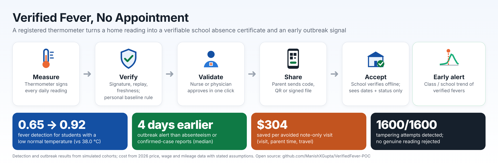
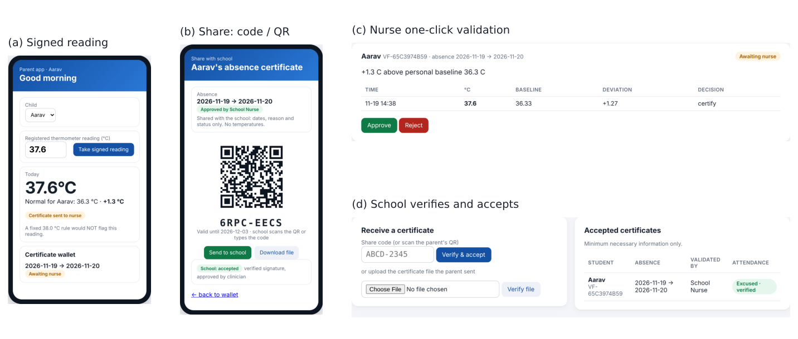
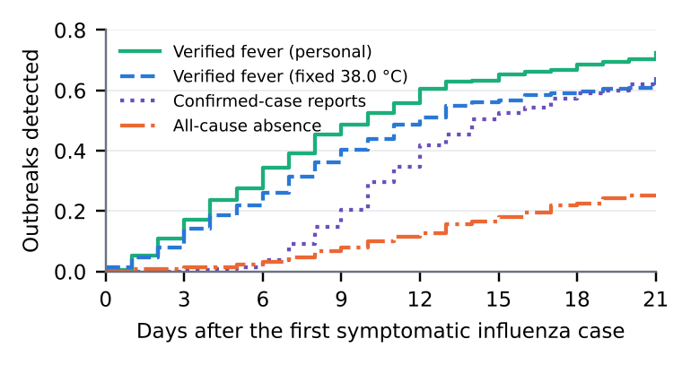

# VerifiedFever POC

**Verified Fever, No Appointment: an IoT portable thermometer for automated digital absence certification and early outbreak alerts in schools.**



A registered thermometer signs every temperature reading. The service checks that the reading is genuine and compares it with the student's own normal temperature and the school's fever policy. When the criteria are met, it creates a signed digital absence certificate that a nurse or physician approves with one click. The parent then **shares the certificate directly with the school** by code, QR or signed file. The school verifies the signature and accepts it, seeing only the absence dates and status, never temperatures. The same verified daily readings also feed **class- and school-level early outbreak alerts**.

This is a small proof of concept for demonstration, and the companion to the IEEE Sensors Letters draft in [`paper/`](paper/). See the [Roadmap](docs/ROADMAP.md) for planned extensions.

> Not a medical device. The system documents a fever reading; it does not diagnose illness.

## Architecture


Decision flow for a single reading: [docs/figures/flow.png](docs/figures/flow.png)

## Screens



## Run the demo (about 3 minutes)

Requires Python 3.10+.

```bash
pip install -r requirements.txt
python -m verifiedfever.app
```

Open http://127.0.0.1:5000. Four demo students are enrolled, each with two weeks of normal readings already recorded.

1. **Parent app**: choose **Aarav** (normal 36.3 °C) and take a reading of **37.6 °C**. A fixed 38.0 °C rule would miss it; the personal baseline rule creates a certificate.
2. Choose **Sofia** (normal 37.1 °C) and take **37.6 °C**: no certificate, because that is only +0.5 °C for her.
3. **Nurse console**: approve Aarav's certificate.
4. **Parent app**: in Aarav's certificate wallet, press **Share with school**. A share code and QR appear. Press **Send to school** (or type the code into the School portal, or download the signed file and upload it there).
5. **School portal**: the certificate is verified and accepted, and the absence is marked *Excused, verified*. Edit a downloaded file and upload it: it is refused.
6. Back in the Parent app, try **Tamper** and **Replay**: both readings are rejected.

## How it works

| Part | File | What it does |
|---|---|---|
| Registered thermometer | `verifiedfever/device.py` | Signs `{device_id, seq, ts, temp_c, site, nonce}` with Ed25519 (simulated in software for the POC) |
| Evidence verifier | `verifiedfever/verifier.py` | Enrollment, student binding, signature, anti-replay sequence, freshness (6 h), plausibility (34 to 43 °C) |
| Rule engine | `verifiedfever/rules.py` | Baseline = median of last 14 afebrile readings. Febrile if `T >= 38.0` or (`T >= 37.5` and `T - baseline >= 1.0`). Escalate at `>= 39.5` or on a 3rd consecutive day |
| Certificates | `verifiedfever/service.py` | Create or extend a certificate (fever day + 24 h), evidence digest, issuer signature, one-click validation |
| Direct sharing | `verifiedfever/service.py` | `share()` gives a share code + signed package; `school_receive()` accepts only a valid, approved, unaltered, unexpired certificate for an enrolled student |
| Web demo + API | `verifiedfever/app.py` | Parent app, nurse console, school portal, verify page; `POST /api/readings`, `POST /api/certificates/<id>/share`, `POST /api/school/receive`, `GET /api/issuer-key` |

All thresholds are in `Policy` (`verifiedfever/rules.py`).

## Results (all reproducible)

```bash
python experiments/synthetic_eval.py   # individual fever detection, 500 students x 90 days, 10 seeds
python experiments/outbreak_eval.py    # school outbreak detection, 480 students x 120 days (~3 min)
python experiments/tamper_eval.py      # 1600 scripted attacks + timing
python experiments/cost_model.py       # cost and time savings
python experiments/make_figures.py && python experiments/make_figures_extra.py
python experiments/make_tables.py      # LaTeX tables and numbers used in the paper
python docs/make_screenshots.py        # UI screenshots (needs Playwright + Chrome)
python docs/make_graphical_abstract.py
pytest -q                              # 24 tests
```

### 1. Individual fever detection

| Rule | Sensitivity | Sensitivity, low-normal students | False certificates per 1000 student-days |
|---|---|---|---|
| Fixed 38.0 °C | 0.81 | 0.65 | 0.6 |
| Fixed 37.5 °C | 0.97 | 0.93 | 14.1 |
| **Personal baseline** | **0.95** | **0.92** | **1.3** |

### 2. Early influenza outbreak detection



| Signal | Outbreaks detected within 21 days | Median delay after first case | Median cases by alert | False-alarm terms |
|---|---|---|---|---|
| **Verified fever, personal** | **72%** | **7 days** | **12** | 7% |
| Verified fever, fixed 38.0 °C | 64% | 8 days | 13 | 6% |
| Confirmed-case reports | 64% | 11 days | 22 | 2% |
| All-cause absence | 25% | 12 days | 32 | 6% |

Among outbreaks that both signals detected, verified-fever surveillance alerted a median **4 days earlier** than absenteeism and **4 days earlier** than confirmed-case reports. These results come from 210 simulated outbreak terms and 300 outbreak-free terms, with detector thresholds tuned on separate terms to a false-alarm rate of at most 10%.

### 3. Cost and time savings

| | Low | Base | High |
|---|---|---|---|
| Net saving per avoided note-only visit | $212 | **$304** | $429 |
| Annual saving, 500-student school | $10,582 | **$30,421** | $64,401 |
| Parent hours saved per year | 75 | **200** | 450 |
| Thermometer payback | 1.4 yr | **0.5 yr** | 0.2 yr |

Inputs: average urgent care price $220 (HCCI, Jan 2026), average hourly wage $37.53 (BLS, May 2026), vehicle cost $0.76/mile (IRS, Jul 2026). Time, distance, share of students and device cost are stated assumptions in `experiments/cost_model.py`.

### 4. Tamper evidence

All 1600 tamper attempts were detected: edited values, back-dated timestamps, replays, impersonation, another student's device, delayed readings, unregistered devices and altered certificates. All 1000 genuine readings were accepted. Median time from reading to certificate is 0.30 ms.

The detection, outbreak and cost results come from **simulations with stated assumptions**. They need to be confirmed with real readings.

## Bench test (to do before submission)

No human participants are needed. Put the thermometer and a calibrated reference probe in a temperature-controlled water bath at 36.0, 37.0, 37.5, 38.0, 39.0 and 40.0 °C, take at least 5 paired readings at each, and record them in `experiments/bench_template.csv` format. Then run:

```bash
python experiments/bench_analysis.py experiments/bench_data.csv
```

## Build the paper

```bash
cd paper && pdflatex main.tex && pdflatex main.tex
```

`paper/main.tex` uses IEEEtran (journal mode); all references are from November 2025 to November 2026. Before submitting, move the content into the official IEEE Sensors Letters template.

## Repository layout

```
verifiedfever/      core library and demo web app
experiments/        detection, outbreak, tamper, cost and bench analyses; figure and table builders
experiments/results saved outputs used by the paper
tests/              pytest suite
docs/               diagrams, figures, screenshots, graphical abstract, roadmap
paper/              IEEE Sensors Letters draft (LaTeX + PDF)
```

## License

MIT, see [LICENSE](LICENSE).
