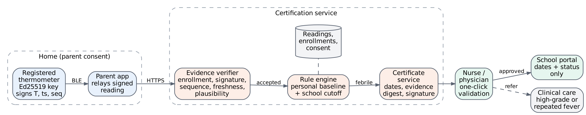
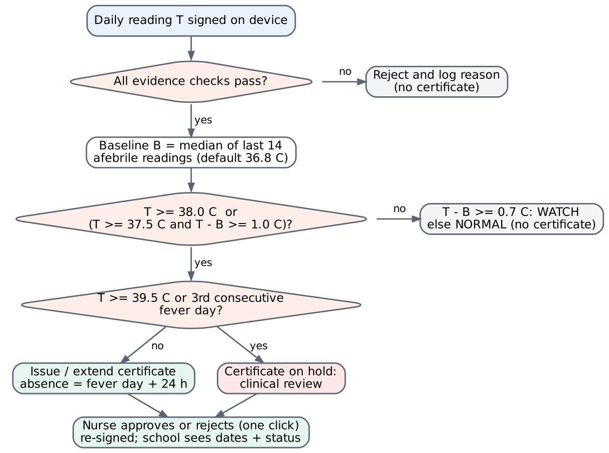
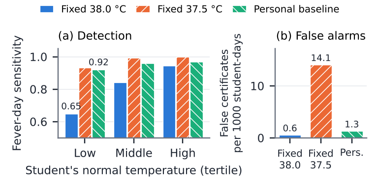

# VerifiedFever POC

**Verified Fever, No Appointment: an IoT portable thermometer for automated digital absence certification in schools.**

A registered thermometer signs every temperature reading. The service checks that the reading is genuine, compares it with the student's own normal temperature and the school's fever policy, and, when the criteria are met, issues a signed digital absence certificate. A school nurse approves it with one click. The school sees only the absence dates and the status, never the temperatures.

This is a small proof of concept for demonstration and for the IEEE Sensors Letters paper in [`paper/`](paper/). It is simple on purpose; see [Roadmap](docs/ROADMAP.md) for the planned extensions.

> Not a medical device. The system documents a fever reading; it does not diagnose illness.

## Architecture



## Decision flow



## Run the demo (about 2 minutes)

Requires Python 3.10+.

```bash
pip install -r requirements.txt
python -m verifiedfever.app
```

Open http://127.0.0.1:5000. Four demo students are enrolled, each with two weeks of normal readings already recorded.

1. **Parent / Thermometer**: choose **Aarav** (normal 36.3 °C) and take a reading of **37.6 °C**. A fixed 38.0 °C rule would miss it; the personal baseline rule issues a certificate.
2. Choose **Sofia** (normal 37.1 °C) and take **37.6 °C**: no certificate, because that is only +0.5 °C for her.
3. Take **39.8 °C** for anyone: the certificate goes to **clinical review**.
4. Press **Try tampering** and **Try replay**: both readings are rejected.
5. **Nurse console**: approve the certificate. Then open the **School portal** and **Verify** pages.

## How it works

| Part | File | What it does |
|---|---|---|
| Registered thermometer | `verifiedfever/device.py` | Signs `{device_id, seq, ts, temp_c, site, nonce}` with Ed25519 (simulated in software for the POC) |
| Evidence verifier | `verifiedfever/verifier.py` | Enrollment, student binding, signature, anti-replay sequence, freshness (6 h), plausibility (34 to 43 °C) |
| Rule engine | `verifiedfever/rules.py` | Baseline = median of last 14 afebrile readings. Febrile if `T >= 38.0` or (`T >= 37.5` and `T - baseline >= 1.0`). Escalate at `>= 39.5` or on a 3rd consecutive day |
| Certificates | `verifiedfever/service.py` | Create or extend a certificate (fever day + 24 h fever-free), evidence digest, issuer signature, one-click validation, minimal school view |
| Web demo + API | `verifiedfever/app.py` | Parent, nurse, school and verify screens; `POST /api/readings`, `GET /api/certificates/<id>`, `GET /api/issuer-key` |

All rule thresholds are in `Policy` (`verifiedfever/rules.py`), so a school can change them without touching code elsewhere.

## Results (reproducible)

```bash
python experiments/synthetic_eval.py   # detection on 500 simulated students x 90 days, 10 seeds
python experiments/tamper_eval.py      # 1600 scripted attacks + timing
python experiments/make_figures.py     # figures
python experiments/make_tables.py      # LaTeX tables and numbers used in the paper
pytest -q                              # 19 tests
```



| Rule | Sensitivity | Sensitivity, low-normal students | False certificates per 1000 student-days |
|---|---|---|---|
| Fixed 38.0 °C | 0.81 | 0.65 | 0.6 |
| Fixed 37.5 °C | 0.97 | 0.93 | 14.1 |
| **Personal baseline** | **0.95** | **0.92** | **1.3** |

All 1600 tamper attempts (edited values, back-dated timestamps, replays, impersonation, another student's device, delayed readings, unregistered devices, altered certificates) were detected, and all 1000 genuine readings were accepted. Median processing time from reading to certificate: 0.30 ms.

These detection results come from a **simulated** cohort with stated assumptions (see `experiments/synthetic_eval.py`). They need to be confirmed with real readings.

## Bench test (to do before submission)

No human participants are needed. Put the thermometer and a calibrated reference probe in a temperature-controlled water bath at 36.0, 37.0, 37.5, 38.0, 39.0 and 40.0 °C, take at least 5 paired readings at each, and record them in `experiments/bench_template.csv` format. Then run:

```bash
python experiments/bench_analysis.py experiments/bench_data.csv
```

This reports Bland-Altman bias, limits of agreement and agreement at the 38.0 °C cutoff, for Section III-C of the paper.

## Build the paper

```bash
cd paper && pdflatex main.tex && pdflatex main.tex
```

`paper/main.tex` uses IEEEtran (journal mode). Before submitting, move the content into the official IEEE Sensors Letters template.

## Repository layout

```
verifiedfever/      core library and demo web app
experiments/        synthetic, tamper and bench analyses; figure and table builders
experiments/results saved outputs used by the paper
tests/              pytest suite
docs/               diagrams (Graphviz sources), figures, roadmap
paper/              IEEE Sensors Letters draft (LaTeX + PDF)
```

## License

MIT, see [LICENSE](LICENSE).
